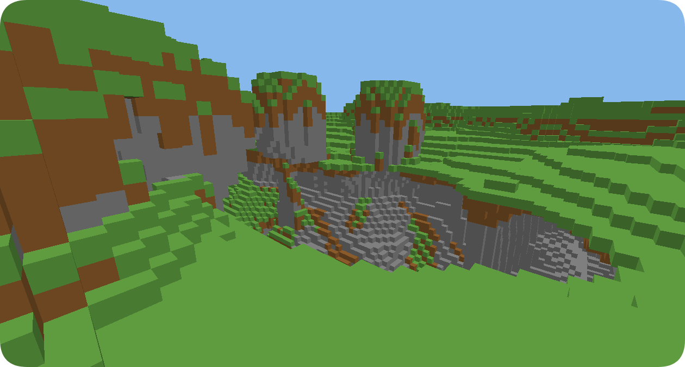

<h1 align="center">batholith</h1>

<p align="center">
  <strong>Minecraft Java 1.21.4 world generation, rebuilt in C++23.</strong><br>
  A batholith is the deep rock that stays put when everything above it erodes away.<br>
  This is the worldgen equivalent: the part of the terrain that survives a rewrite.
</p>

<p align="center">
  <a href="https://github.com/immutex/batholith/actions/workflows/ci.yml"></a>
  <a href="LICENSE"></a>
  
  
  
</p>

<p align="center">
  
  
</p>

<p align="center">
  
</p>

[What this is](#what-this-is) · [Why it's fast](#why-its-fast) · [Verified](#verified) ·
[Speed](#speed) · [Build](#build) · [Use](#use) · [Layout](#layout) ·
[Contributing](#contributing)

## What this is

I wanted to know how fast Minecraft's world generation runs in a compiled language, so I
reimplemented it from scratch in C++23. Give it a seed and a chunk coordinate and it produces the
block palette vanilla would put there. There's no gameplay and no networking, just generation and
a small debug viewer.

It's a learning project. I was after the limits: how much of vanilla's density graph survives a
rewrite, which parts cost anything, and where the honest answer turned out to be that another
project was faster. Most of `docs/` is the record of that, including the parts I got wrong.

The viewer is there so you can check the output by eye rather than take my word for it:

```text
$ batholith view --seed 0 --frames 30 --walk 1.5 --screenshot render.ppm
renderer: NVIDIA GeForce RTX 5060/PCIe/SSE2
version:  3.3.0 NVIDIA 610.74
frames=30 distinct=yes
```

WASD to move, mouse to look, Space and Shift to rise and sink, Ctrl to fly. Chunks generate and
mesh on a background thread, so walking doesn't stall.

`--no-capture` runs headless and fails the command when the frame is one flat colour. That check
is how I caught a mesher bug where four of the six cube faces were wound backwards and got
culled.

## Why it's fast

Vanilla's `interpolated` node evaluates the density graph on a 4×8×4 block grid, 1,225 points per
chunk, then trilinearly interpolates to 98,304 blocks. Doing it per block is 80× more work. The
651-node graph, 430 spline points and 43 noises come from the official 1.21.4 data pack via
`tools/gen_router.py`, so nothing is hand-transcribed or parsed at startup.

Over a full chunk, `final_density` costs 12.7 node evaluations per block and zero noise samples:
all the noise happens while filling the lattice. That split is about a third lattice build and two
thirds per-block evaluation, which is why the lattice is where the wins are. Caching the trilinear
cell per block position gave +12.4%, measured by alternating builds in one session.

Per-thread scratch avoids allocating in the hot loop, and the lattice and flat caches are filled
in chunk-local coordinates so the origin isn't folded into every lookup. Only the nine router
outputs the generator reads are prepared. That prunes outputs, not individual nodes: all 651 nodes
are reachable from those roots, so there's no node-level pruning win to claim.

## Verified

Against the official 1.21.4 server jar, executed via reflection: `Xoroshiro128PlusPlus`,
MD5-based positional seeds, `Mth.getSeed`'s 32-bit multiply overflow, `PerlinNoise.wrap`'s 2²⁵
modulus, `NormalNoise`'s value factor, `BlendedNoise`'s draw order, `CubicSpline`'s float
arithmetic, and `WeirdScaledSampler`'s scale steps.

Against [`cubiomes`](https://github.com/Cubitect/cubiomes), from the same derived RNG state, the
climate noise agrees to a few double ULP (max error `1.4e-15`). A wrong amplitude table or octave
seed would show up around 0.1, twelve orders of magnitude larger, so this catches what unit tests
alone wouldn't.

234 checks, 0 failures on GCC 16.1, Clang 22 and MSVC 19.44, all three building warning-free under
`-Wall -Wextra -Wpedantic -Wconversion -Wsign-conversion` (MSVC `/W4`). The full spec, and the list
of things I deliberately left out, is in [`docs/worldgen.md`](docs/worldgen.md).

## Speed

AMD Ryzen 5 5500X3D (6 cores / 12 threads), GCC 16.1, `-O3 -march=native`, seed 0, side 16 (256
chunks, 25,165,824 blocks), five repeats of best-of-3.

| threads | blocks/s | blocks/s/core | chunks/s |
|---|---|---|---|
| 1 | 4.6-4.7 M | 4.6-4.7 M | 46-48 |
| 6 | 22.2-23.7 M | 3.7-4.0 M | 226-241 |
| 12 | 34.1-35.7 M | 2.8-3.0 M | 347-364 |

Medians 4.66 M, 22.72 M and 34.43 M. Scaling is 4.9× at 6 threads and 7.4× at 12, sublinear
because the 5500X3D has 6 physical cores and the 12 logical threads share FP units. Raw data is in
[`docs/bench/batholith_chunk.csv`](docs/bench/batholith_chunk.csv).

Absolute numbers move with machine state. An identical run 20 minutes earlier on a busier machine
gave 3.2 M, so only A/B comparisons by alternating builds within one session are treated as
evidence of a speedup.

An earlier revision of this file reported figures about 2× too high. `thread_pool(n)` spawned n
workers and also ran work on the calling thread, so `--threads 1` used two threads while the
benchmark divided by one. Fixed, and `tests/test_thread_pool.cxx` now measures peak concurrency to
keep it fixed.

### Noise layer, head to head

The one comparison here that is like-for-like, because every engine evaluates the identical
function: 9-octave Perlin, `firstOctave = -9`, amplitudes `{1,1,2,2,2,1,1,1,1}`, which is
Minecraft's continentalness noise.

| engine | ns/sample | notes |
|---|---|---|
| batholith | 357-466 | scalar, both of vanilla's ladders |
| cubiomes | 1118-1207 | scalar, both ladders |
| FastNoise2 | 1531-1761 | scalar `GenSingle3D`, 18-node additive tree |
| FastNoise2 | 89-91 | `GenPositionArray3D`, AVX2 batch |

FastNoise2 is built as an explicit additive node tree rather than `FractalFBm`, because
`FractalFBm` applies a constant geometric gain and can't express Minecraft's non-geometric
amplitudes. Its values aren't compared against vanilla's, since it uses its own gradient tables
and produces a different field.

Its scalar and batch modes differ by 17×. The batch API is what the library is built for, and
calling it one point at a time leaves most of the machine idle.

### Chunk generation, head to head

Cuberite's generator links standalone, so it's benchmarked too. It came out far faster: 41-96 M
blocks/s/core, median 82, against batholith's 4.7 M. That's on a terrain-only pipeline with no
caves, ores or decorations. Its shape generator is a coarse 3D-noise heightfield; batholith walks
the full 651-node density graph on a 1,225-point lattice and then does per-block caves and
aquifers. They aren't doing the same amount of work, so the number mostly tells you what the
extra fidelity costs.

Luanti's mapgen was verified to run, but its per-chunk cost can't be separated from the server's
emerge queue, so it isn't benchmarked. Build recipes and the full method are in
[`docs/competitors.md`](docs/competitors.md) and
[`docs/benchmark.md`](docs/benchmark.md).

Published figures from other projects are cross-CPU and cross-pipeline, so they're only useful as
an order of magnitude. Vanilla with Chunky reports 13-18 M blocks/s on four threads; Cuberite and
Luanti report around 5-6 M on much older hardware.

batholith generates terrain, caves, aquifers and surface material. It doesn't light, decorate or
serialize chunks, which is a large share of what a full server spends.

## Build

```
cmake --preset release
cmake --build --preset release
ctest --preset release
```

A C++23 compiler (GCC 13+, Clang 17+, MSVC 19.36+) and CMake 3.25+. No dependencies. The viewer
only runs on Windows and needs `opengl32`; it's skipped elsewhere.

## Use

```cpp
#include <batholith/generator.hxx>

batholith::generator gen(0);
batholith::chunk_buffer chunk;
gen.generate(batholith::chunk_pos{0, 0}, chunk);
```

From the command line:

```
batholith gen   --seed 0 --chunks 256 --threads 12 --dump
batholith bench --side 16 --threads 12 --repeats 5
batholith view  --seed 0 --walk 2
```

`batholith --help` lists every subcommand. `terrain` and `noise` are compiled in only when
their competitor checkouts are present; `view` only on Windows.

## Layout

```
include/batholith/   public headers (.hxx)
src/                 implementations (.cxx) and the subcommands behind src/main.cxx
src/bridges/         C shims that call into the competitor libraries
tests/               test suite
tools/gen_router.py  regenerates the router tables from the vanilla data pack
docs/                worldgen spec, benchmark methodology, competitor recipes, raw CSVs
docs/images/         the preview render shown above
```

## Contributing

Issues and pull requests are welcome. The most useful thing you can send is a bug report with a
seed and a chunk coordinate where generation disagrees with vanilla, since that is the one kind of
report I cannot produce myself.

Read [`CONTRIBUTING.md`](CONTRIBUTING.md) first. The short version: build warning-free, keep the
diff to one change, and bring a measurement if the change is meant to affect speed. Performance
claims here follow a strict method, because absolute numbers on this machine move by a factor of
two between sessions and two earlier results in this repository were wrong for exactly that
reason.

Participation is covered by the [`CODE_OF_CONDUCT.md`](CODE_OF_CONDUCT.md).

## License

MIT. See [`LICENSE`](LICENSE).
